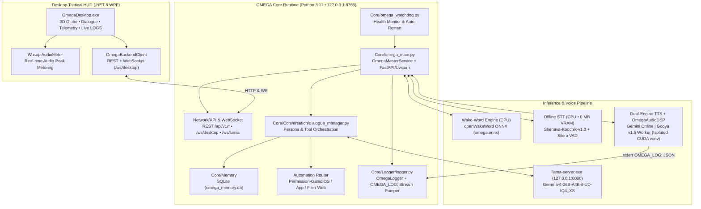

# OMEGA — Local & Hybrid Persian Tactical AI Voice Assistant


-F59E0B?style=flat-square)
-8B5CF6?style=flat-square)

**OMEGA (اُمگا)** is a local-first, hybrid Persian/English AI voice assistant and tactical desktop command runtime built for Windows. It combines a local quantized LLM (`llama.cpp`), zero-VRAM offline Persian speech recognition (`Shenava` + `Silero VAD`), a dual-engine neural speech synthesizer (`Gooya Bozorg v1.5` local GPU + Gemini Online), persistent SQLite memory, permission-gated Windows automation, and a native `.NET 8 WPF` tactical HUD.

---

## Key Capabilities

- **Local High-Reasoning LLM Backend:** Runs `Gemma-4-26B-A4B-it-UD-IQ4_XS.gguf` locally through `llama-server.exe` (`127.0.0.1:8080`) with automated lifecycle management and Persian/English engineering dialogue orchestration.
- **Zero-VRAM Offline Persian STT:** Powered by `Shenava-Koochik-v1.0` (`sherpa-onnx`) paired with `Silero VAD` strictly on CPU (`0 MB VRAM`) plus Persian Inverse Text Normalization (`persian_itn.py`), preserving full GPU headroom for inference and speech synthesis.
- **Dual-Engine Neural TTS:**
  - **Local GPU Engine:** `Gooya Bozorg v1.5` running in an isolated Python 3.11 CUDA BF16 subprocess (`gooya_worker.py`) with custom speaker reference voice cloning.
  - **Online Engine:** Gemini TTS for low-latency cloud synthesis with seamless fallback.
- **Native `.NET 8 WPF` Tactical HUD (`OmegaDesktop`):** Real-time 3D interactive Earth globe (`CosmicSphereHost`), live WASAPI audio session peak metering, dialogue terminal, hardware telemetry (`CPU / GPU / VRAM / Temp / RAM`), diagnostics deck, and live streaming `LOGS` tab.
- **Unified Structured Logging (`OMEGA_LOG:`):** Centralized logging to `Logs/omega.log`, `Logs/omega.jsonl`, and `Logs/errors.log`, featuring a non-blocking subprocess stream pumper that bridges isolated worker logs directly into disk files and the live Desktop HUD via WebSocket.
- **Persistent Memory & Audit Trail:** Local SQLite database (`Data/Memory/omega_memory.db`) storing conversation history, long-term user facts, preferences, and security audit logs.
- **Permission-Gated System Automation:** Modular Windows control (application launcher, file operations, OS controls, web search, auto-start management) guarded by risk-level permission checks.
- **Multi-Device Ready:** Authenticated REST API and WebSocket endpoints supporting both the primary Desktop HUD (`/ws/desktop`) and thin-client remote microphone/HUD terminals (`/ws/lumia`).

---

## System Architecture



---

## Tech Stack & Compute Allocation

| Subsystem | Implementation | Compute Target | Key Files |
| :--- | :--- | :--- | :--- |
| **Core Backend** | Python 3.11.9, FastAPI, Uvicorn, Win32 Mutex | CPU | `Core/omega_main.py`, `Core/omega_watchdog.py` |
| **LLM Inference** | `llama.cpp` (`llama-server.exe`), Gemma-4-26B-A4B | GPU (CUDA) | `Core/ModelManager/llamacpp_manager.py`, `Core/AI/llm_client.py` |
| **Offline STT** | `Shenava-Koochik-v1.0` (`sherpa-onnx`) + `Silero VAD` | CPU (0 MB VRAM) | `Voice/STT/stt_engine.py`, `Voice/STT/persian_itn.py` |
| **Wake-Word** | `openWakeWord` (ONNX Runtime) | CPU | `Voice/WakeWord/wakeword_engine.py` |
| **Local TTS** | `Gooya Bozorg v1.5` (Isolated Python 3.11 venv, PyTorch CUDA BF16) | GPU (CUDA) | `Voice/TTS/gooya_worker.py`, `Voice/TTS/tts_engine.py` |
| **Online TTS** | Gemini TTS API | Cloud | `Voice/TTS/tts_engine.py` |
| **Audio DSP** | Custom gain/filtering pipeline (`OmegaAudioDSP`) | CPU | `Voice/AudioDSP/omega_dsp.py` |
| **Desktop HUD** | `.NET 8.0` WPF (`net8.0-windows`) | CPU / DirectX | `Desktop/UI/OmegaDesktop.sln` |
| **Persistence** | SQLite 3 (`conversations`, `user_facts`, `preferences`, `security_audit`) | Disk | `Data/Memory/omega_memory.db` |
| **Logging** | `OmegaLogger` + `OMEGA_LOG:` JSON IPC protocol | Disk + Live WS | `Core/Logger/logger.py` |

---

## Project Structure

```text
OMEGA/
├── Automation/
│   ├── Applications/          # Application launching & process control (app_manager.py)
│   ├── FileSystem/            # Controlled filesystem operations (file_manager.py)
│   ├── Security/              # Risk levels & security audit enforcement (permission_manager.py)
│   ├── Web/                   # Web search integration (web_search.py)
│   ├── Windows/               # OS controls & Registry/Task auto-start (startup_manager.py)
│   └── automation_router.py   # Central tool dispatcher
├── Configuration/
│   └── config.json            # Portable project configuration (relative paths)
├── Core/
│   ├── AI/                    # LLM HTTP/streaming client (llm_client.py)
│   ├── Config/                # Schema & dynamic root config loader (config_loader.py)
│   ├── Conversation/          # OMEGA persona & dialogue manager (dialogue_manager.py)
│   ├── Logger/                # Unified logger & OMEGA_LOG: stream pumper (logger.py)
│   ├── Memory/                # SQLite schema & semantic memory manager (db_manager.py)
│   ├── ModelManager/          # llama-server lifecycle controller (llamacpp_manager.py)
│   ├── omega_main.py          # Primary service entrypoint (OmegaMasterService)
│   └── omega_watchdog.py      # Health watchdog & automatic crash supervisor
├── Data/
│   ├── Memory/                # Persistent SQLite database (omega_memory.db)
│   └── Models/                # Local LLM, STT, Wake-Word & isolated Gooya TTS venv (gitignored)
├── Desktop/
│   ├── Monitoring/            # Real-time CPU/GPU/VRAM/Temp telemetry (hardware_monitor.py)
│   └── UI/                    # .NET 8 WPF Tactical HUD (OmegaDesktop.sln / OmegaDesktop.csproj)
├── Documentation/
│   └── API_CONTRACT.md        # REST & WebSocket protocol specification
├── Installer/
│   └── start_omega_hidden.vbs # Windowless background watchdog launcher
├── Logs/                      # Runtime logs (omega.log, omega.jsonl, errors.log)
├── Network/
│   ├── API/                   # FastAPI REST endpoints (rest_server.py)
│   ├── Authentication/        # PIN pairing & token auth (auth_manager.py)
│   └── WebSocket/             # Real-time HUD & thin-client sockets (ws_server.py)
└── Voice/
    ├── AudioDSP/              # Audio conditioning (omega_dsp.py)
    ├── STT/                   # Offline Shenava + Silero VAD + Persian ITN
    ├── TTS/                   # Dual-engine TTS manager & isolated gooya_worker.py
    ├── WakeWord/              # ONNX wake-word engine (targets Data/Models/wakeword/omega.onnx)
    └── voice_orchestrator.py  # End-to-end voice turn state machine
```

---

## API & Real-Time IPC Overview

All endpoints are served locally on `127.0.0.1:8765` (full schema in `Documentation/API_CONTRACT.md`):

| Type | Endpoint | Purpose |
| :--- | :--- | :--- |
| `GET` | `/api/v1/health` · `/health` · `/ping` | Service health checks & watchdog liveness probe |
| `GET` | `/api/v1/status` | Runtime state, active LLM, voice mute state, connected clients |
| `GET` | `/api/v1/telemetry` | Live CPU, GPU, VRAM, temperature, and RAM metrics |
| `POST` | `/api/v1/chat` | Text/voice turn execution returning structured & spoken response |
| `GET/POST` | `/api/v1/voice/config` | Runtime TTS/STT/audio configuration inspection and updates |
| `GET/POST` | `/api/v1/memory/facts` | Persistent SQLite user fact retrieval and management |
| `POST` | `/api/v1/pair` | PIN-based client pairing (`OmegaDesktopPC` / remote devices) |
| `WS` | `/ws/desktop` | Bidirectional HUD telemetry, dialogue events & `"subscribe_logs"` live stream |
| `WS` | `/ws/lumia` | Thin-client wireless microphone & remote terminal stream |

**Subprocess Logging Protocol (`OMEGA_LOG:`):** Isolated worker processes (such as `Voice/TTS/gooya_worker.py`) emit structured JSON lines prefixed with `OMEGA_LOG:` over `stderr`. `Core/Logger/logger.py` ingests these frames asynchronously into `Logs/omega.log`, `Logs/omega.jsonl`, and connected WebSocket HUD clients without blocking audio synthesis.

---

## Prerequisites & Setup

### System Requirements
- **OS:** Windows 11 (64-bit)
- **GPU:** NVIDIA GPU with CUDA support (tested on RTX 3080 10GB)
- **Python:** Python `3.11.9`
- **Desktop SDK:** `.NET 8.0 SDK` (`net8.0-windows`)

### 1. Main Python Environment
```powershell
python -m venv .venv
.\.venv\Scripts\python.exe -m pip install --upgrade pip
# Install project dependencies into .venv
```

### 2. Isolated Gooya Local TTS Environment
Gooya Bozorg v1.5 runs in a dedicated virtual environment at `Data/Models/gooya/venv` (Python `3.11.9`, PyTorch with CUDA) to isolate GPU TTS dependencies from the core runtime. Place your speaker voice reference at:
```text
Data/Models/gooya/speaker_reference_clean.wav
```

### 3. Local Models & Configuration
Place model binaries under `Data/Models/` (excluded from Git) and verify relative paths inside `Configuration/config.json`:
- **LLM:** `Gemma-4-26B-A4B-it-UD-IQ4_XS.gguf` via `llama-server.exe`
- **Offline STT:** `Data/Models/stt/shenava/` (`model.onnx` + `silero_vad.onnx`)
- **Custom Wake-Word:** `Data/Models/wakeword/omega.onnx` *(if not yet present, `wakeword_engine.py` logs a warning and gracefully falls back to a bundled `openWakeWord` ONNX model so startup never fails)*

### 4. Build Desktop HUD (`.NET 8 WPF`)
```powershell
dotnet build Desktop/UI/OmegaDesktop.sln -c Release
```
Output binary: `Desktop/UI/bin/Release/net8.0-windows/OmegaDesktop.exe`

---

## Running OMEGA

### Standard Development Launch (Backend + Desktop HUD)
```powershell
# 1. Start the core service (or Core\omega_watchdog.py for auto-restart supervision)
.\.venv\Scripts\python.exe Core\omega_main.py

# 2. Launch the Desktop Tactical HUD
.\Desktop\UI\bin\Release\net8.0-windows\OmegaDesktop.exe
```

### Silent Background Auto-Start
Use the built-in startup toggle in the Desktop HUD or `Automation/Windows/startup_manager.py`, which registers `OMEGA_AI_System` pointing to `Installer\start_omega_hidden.vbs` (resolving project paths dynamically with zero hardcoded directory dependencies).

---

## Roadmap

- [x] Core modular FastAPI/WebSocket runtime & health watchdog (`omega_main.py`, `omega_watchdog.py`)
- [x] Zero-VRAM offline Persian STT (`Shenava-Koochik-v1.0` + `Silero VAD` + Persian ITN)
- [x] Dual-Engine TTS (`Gooya Bozorg v1.5` isolated CUDA worker + Gemini Online)
- [x] Unified logging pipeline (`OMEGA_LOG:` protocol + live HUD `LOGS` tab)
- [x] Native `.NET 8 WPF` Tactical HUD (`OmegaDesktop`) with 3D Earth Globe & WASAPI metering
- [x] Fully portable dynamic root path resolution across Python, C#, and Config
- [ ] Custom low-latency CPU wake-word model training & deployment (`Data/Models/wakeword/omega.onnx`)
- [ ] Dedicated thin-client remote microphone & HUD terminal integration (`/ws/lumia`)

---

## License

Private / Engineering Project — All rights reserved unless otherwise specified.